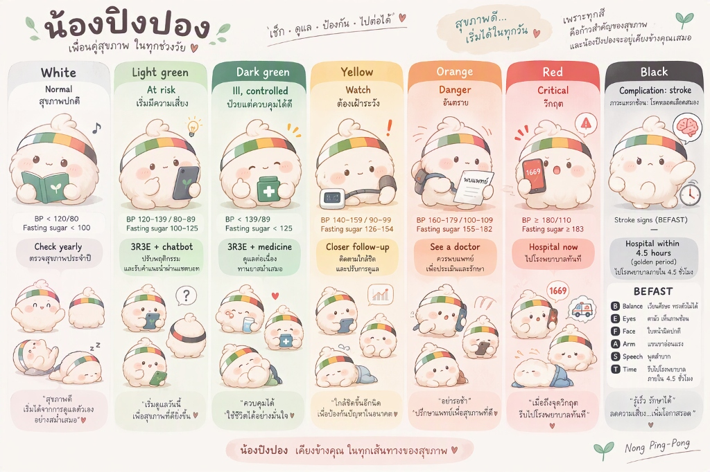
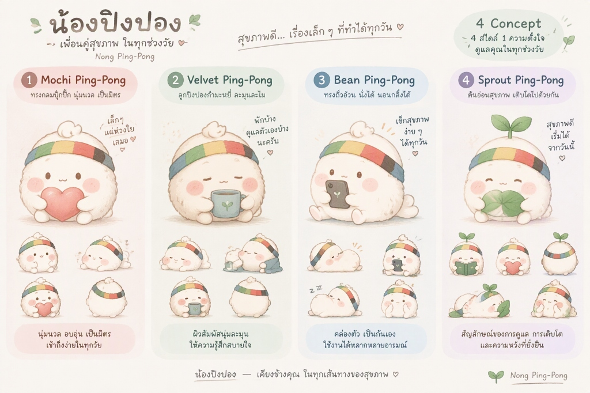

# ssime-pbri-model: น้องปิงปอง (Nong Ping-Pong) 🏓💚

> **เพื่อนคู่สุขภาพ ในทุกช่วงวัย**  
> *"สุขภาพดี... เริ่มได้ในทุกวัน | เช็ก • ดูแล • ป้องกัน • ไปต่อได้"*

โครงการออกแบบคาแรคเตอร์และสื่อการสื่อสารสุขภาพ **"น้องปิงปอง"** โดยประยุกต์ใช้โมเดลปิงปองจราจรชีวิต 7 สี (Ping-Pong 7 Colors Traffic Light Model) สำหรับการคัดกรอง เฝ้าระวัง และดูแลสุขภาพโรคไม่ติดต่อเรื้อรัง (NCDs) เช่น โรคความดันโลหิตสูงและเบาหวาน รวมถึงภาวะแทรกซ้อนจากโรคหลอดเลือดสมอง (Stroke)

---

## 📸 สื่อและภาพประกอบ (Assets)

### 1. โมเดลปิงปองจราจรชีวิต 7 สี (Ping-Pong 7 Colors Health Model)


เกณฑ์การประเมินระดับสุขภาพและการปฏิบัติตัว:

| สี | สถานะสุขภาพ | ค่าความดันโลหิต (BP) | ค่าน้ำตาลในเลือด (Fasting Sugar) | คำแนะนำ / การดูแล |
| :---: | :--- | :---: | :---: | :--- |
| **White** (ขาว) | **ปกติ (Normal)** | < 120/80 | < 100 | **Check yearly:** ตรวจสุขภาพประจำปี |
| **Light green** (เขียวอ่อน) | **เริ่มเสี่ยง (At risk)** | 120–139 / 80–89 | 100–125 | **3R3E + chatbot:** ปรับเปลี่ยนพฤติกรรม รับคำแนะนำผ่านแชทบอท |
| **Dark green** (เขียวเข้ม) | **ป่วยคุมได้ดี (Ill, controlled)** | < 139/89 | < 125 | **3R3E + medicine:** ดูแลตนเองต่อเนื่อง ทานยาสม่ำเสมอ |
| **Yellow** (เหลือง) | **เฝ้าระวัง (Watch)** | 140–159 / 90–99 | 126–154 | **Closer follow-up:** ติดตามอาการใกล้ชิด และปรับการดูแล |
| **Orange** (ส้ม) | **อันตราย (Danger)** | 160–179 / 100–109 | 155–182 | **See a doctor:** ควรพบแพทย์เพื่อประเมินและรับการรักษา |
| **Red** (แดง) | **วิกฤต (Critical)** | ≥ 180/110 | ≥ 183 | **Hospital now:** รีบไปโรงพยาบาลทันที (โทร 1669) |
| **Black** (ดำ) | **ภาวะแทรกซ้อน (Stroke)** | สัญญาณเตือน BEFAST | — | **Hospital within 4.5 hours:** Golden period รีบไป รพ. ภายใน 4.5 ชม. |

#### สัญญาณเตือนโรคหลอดเลือดสมอง (BEFAST)
* **B (Balance):** เวียนศีรษะ เดินเซ ทรงตัวไม่ได้
* **E (Eyes):** ตาพร่ามัว มองเห็นภาพซ้อนเฉียบพลัน
* **F (Face):** ใบหน้าเบี้ยว มุมปากตก ยิ้มไม่เท่ากัน
* **A (Arm):** แขนหรือขาอ่อนแรง ชาครึ่งซีก
* **S (Speech):** พูดไม่ชัด พูดไม่ออก หรือลิ้นแข็ง
* **T (Time):** รีบนำส่งโรงพยาบาลให้ทันภายใน 4.5 ชั่วโมง

---

### 2. แนวคิดการออกแบบคาแรคเตอร์: 4 Concept Styles


1. **Mochi Ping-Pong:** ทรงกลมปุ๊กปิ๊ก นุ่มนวล เป็นมิตร เข้าถึงง่ายในทุกวัย
2. **Velvet Ping-Pong:** ลูกปิงปองสัมผัสนุ่มละมุน ให้ความรู้สึกสบายใจและอบอุ่น
3. **Bean Ping-Pong:** ทรงถั่วอ้วน คล่องตัว เป็นกันเอง ใช้งานได้หลากหลายอารมณ์
4. **Sprout Ping-Pong:** สัญลักษณ์ของการดูแล การเติบโต และความหวังที่ยั่งยืน

---

### 3. คอนเซ็ปต์คาแรคเตอร์: Concept A – E


* **Concept A (Ping-Pong Spirit):** ลูกปิงปองนุ่มฟู นุ่มนวล อบอุ่น เป็นมิตร
* **Concept B (Smart Health Companion):** ผู้ช่วยสุขภาพอัจฉริยะ ทันสมัย เข้าใจง่าย
* **Concept C (Ping-Pong Bird):** ลูกนกปิงปอง สดใส มีชีวิตชีวา สื่อถึงการเติบโตและการดูแลต่อเนื่อง
* **Concept D (Ping-Pong Sprout):** ต้นอ่อนสุขภาพ สัญลักษณ์ของการเริ่มต้นดูแลตัวเอง
* **Concept E (Ping-Pong Friend):** เพื่อนร่วมทางที่คอยดูแลและอยู่เคียงข้างคุณเสมอในทุกช่วงวัย

---

## 📁 โครงสร้างโปรเจกต์ (Project Structure)

```text
ssime-pbri-model/
├── assets/
│   ├── 01-nong-ping-pong-7-colors-health-model.jpg
│   ├── 02-nong-ping-pong-4-concepts.jpg
│   └── 03-nong-ping-pong-character-designs.jpg
└── README.md
```
