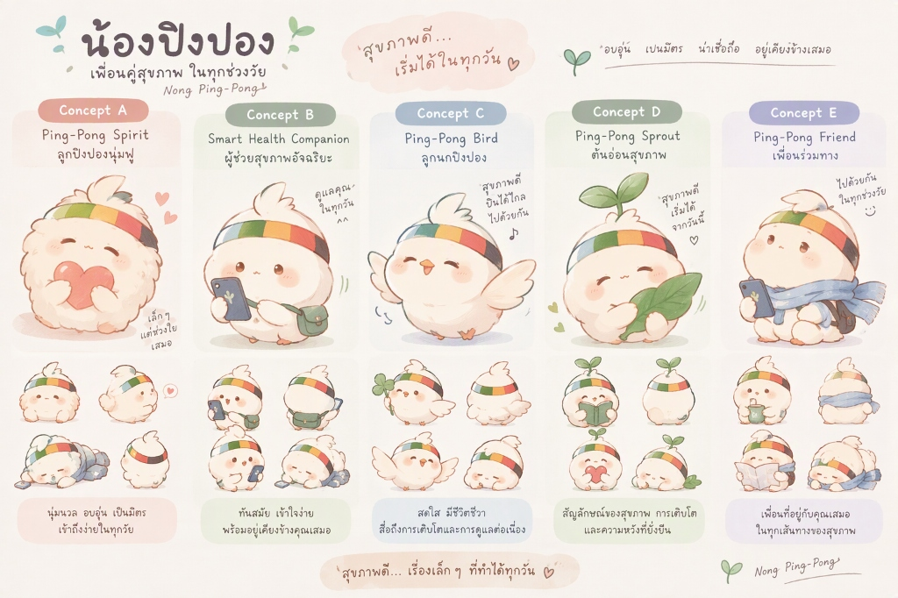

# SSIME PBRI Model: Stroke Integration AI Project 🏓🧠

> **AI Foundations for Digital Health · Capstone / University of Waikato**  
> *"Detect early. Support continuously. Measure what changes."*  
> *"ตรวจเร็ว ดูแลต่อเนื่อง วัดผลได้"*

An AI-driven digital health initiative to screen, support, and follow up working-age adults (aged 35–70) with hypertension (HT) and/or diabetes mellitus (DM) who are at high risk of stroke.

โครงการพัฒนานวัตกรรม AI และโมเดลสุขภาพดิจิทัล เพื่อการคัดกรอง เฝ้าระวัง และดูแลกลุ่มคนวัยทำงานอายุ 35–70 ปี ที่มีภาวะความดันโลหิตสูงและเบาหวาน ซึ่งมีความเสี่ยงต่อโรคหลอดเลือดสมอง (Stroke)

---

## 📌 สารบัญ (Table of Contents)
1. [ความเป็นมาและปัญหา (The Problem)](#-ความเป็นมาและปัญหา-the-problem)
2. [กรอบการทำงาน SSIME Framework](#-กรอบการทำงาน-ssime-framework)
3. [โมเดลการพัฒนา 3 ระยะ (PBRI Model)](#-โมเดลการพัฒนา-3-ระยะ-pbri-model)
4. [Phase I: AI Screening Tool (ระบบคัดกรองอัจฉริยะ)](#-phase-i-ai-screening-tool)
5. [เกณฑ์ปิงปองจราจรชีวิต 7 สี (7-Colour Life Traffic-Light)](#-เกณฑ์ปิงปองจราจรชีวิต-7-สี-7-colour-life-traffic-light)
6. [Phase II: AI Intervention & น้องปิงปอง Chatbot](#-phase-ii-ai-intervention--น้องปิงปอง-chatbot)
7. [Phase III: Monitoring & Evaluation (การติดตามและประเมินผล)](#-phase-iii-monitoring--evaluation)
8. [แผนงาน 5 ปี และงบประมาณ (5-Year Plan & Budget)](#-แผนงาน-5-ปี-และงบประมาณ-5-year-plan--budget)
9. [สไลด์นำเสนอ & เอกสาร (Presentations & Docs)](#-สไลด์นำเสนอ--เอกสาร-presentations--docs)
10. [ภาพสื่อและคาแรคเตอร์ดีไซน์ (Assets & Character Designs)](#-ภาพสื่อและคาแรคเตอร์ดีไซน์-assets--character-designs)
11. [โครงสร้างโปรเจกต์ (Project Structure)](#-โครงสร้างโปรเจกต์-project-structure)

---

## 🎯 ความเป็นมาและปัญหา (The Problem)

* **กลุ่มเป้าหมาย (Users):** วัยทำงานอายุ 35–70 ปี ที่เป็นโรคความดันโลหิตสูง (HT) และ/หรือ เบาหวาน (DM) ซึ่งเป็นกลุ่มเสี่ยงสำคัญต่อการเกิดโรคหลอดเลือดสมอง (Stroke)
* **ช่องว่างปัญหาหลักที่พบ:**
  * **K (Knowledge):** ขาดความรู้ความเข้าใจ ไม่ทราบว่าผลตรวจสุขภาพหรือค่าตัวเลขของตนเองหมายถึงอะไร
  * **A (Attitude):** ทัศนคติยังไม่ตระหนักถึงความสำคัญของการดูแลตนเองในระยะแรกเริ่ม
  * **Missed Medication:** ลืมทานยา ทานยาไม่สม่ำเสมอ ทำให้ควบคุมความดันโลหิตและระดับน้ำตาลไม่ได้
  * **Risk Behaviours:** พฤติกรรมเสี่ยงสะสม เช่น ขาดการออกกำลังกาย สูบบุหรี่ ดื่มแอลกอฮอล์ และบริโภคอาหารรสจัด

---

## 🔄 กรอบการทำงาน SSIME Framework

กระบวนการดูแลแบบ 5 ขั้นตอนแบบครบวงจร (One 5-step cycle that loops back to screening):

```text
 ┌──────────────┐
 │ S: Screening ├─► BEFAST, Thai CV Risk Score, ปิงปองจราจรชีวิต 7 สี
 └──────┬───────┘
        ▼
 ┌──────────────┐
 │  S: Stroke   ├─► ป้องกันและตรวจจับอาการ Stroke ให้เร็วที่สุด (Golden Period 4.5 ชม.)
 └──────┬───────┘
        ▼
 ┌──────────────┐
 │I:Intervention├─► ภารกิจ 3R3E + แชตบอตน้องปิงปองที่ตอบอิงตามคู่มือมาตรฐาน
 └──────┬───────┘
        ▼
 ┌──────────────┐
 │ M:Monitoring ├─► ติดตามประเมินผลอย่างต่อเนื่องที่ 3, 6 และ 12 เดือน
 └──────┬───────┘
        ▼
 ┌──────────────┐
 │ E:Evaluation ├─► วัดผลรอบด้าน: KAP, คุณภาพชีวิต (QoL), และความคุ้มค่า (SROI)
 └──────┬───────┘
        │
        └─────────► ↻ วนกลับไปคัดกรองซ้ำ (Re-screening) เพื่อติดตามการเปลี่ยนสีสุขภาพ
```

---

## 🏗 โมเดลการพัฒนา 3 ระยะ (PBRI Model)

| ระยะ (Phase) | ช่วงเวลา | เป้าหมายสำคัญ (Objectives & Activities) | ตัวชี้วัดหลัก (KPI) |
| :--- | :---: | :--- | :--- |
| **Phase I** | **Year 1** | **AI Screening Tool for Stroke**<br>• ทบทวนวรรณกรรม BEFAST, CV Risk, ปิงปอง 7 สี<br>• พัฒนาต้นแบบเครื่องมือคัดกรอง และเตรียม Training Data | 1 AI-Screening Module (Precision 50% สำหรับเสียงและภาพ, กฎความเสี่ยงตรงกับพยาบาล 100%) |
| **Phase II** | **Year 2** | **AI Intervention**<br>• พัฒนาระบบ `3R3E → Chatbot → AI-Learning`<br>• นำ Intervention ไปทดสอบและใช้งานจริงในชุมชน | AI + 3R3E Module บูรณาการในชุมชน |
| **Phase III** | **Years 3–5** | **Monitoring & Evaluation AI**<br>• จัดทำรายงานติดตามผลที่ 3, 6, 12 เดือน<br>• ศึกษาติดตามกลุ่มประชากรระยะยาว (5-Year Cohort Study) | Monitoring & Evaluation Module |

---

## 🔍 Phase I: AI Screening Tool

เครื่องมือคัดกรองแบ่งออกเป็น 2 ส่วนหลัก โดยผสาน AI และ Clinical Rules:

1. **ส่วนที่ 1: ตรวจจับสโตรกเฉียบพลันด้วย AI (BEFAST Detection)**
   * ใช้ AI วิเคราะห์ภาพถ่ายใบหน้า (Face) และฟังเสียงพูด (Speech/Voice) เพื่อตรวจจับอาการ Stroke ที่กำลังเกิดขึ้น
   * หากผิดปกติ → เชื่อมต่อโทร **1669** ทันที
   * *KPI:* Precision 50%
2. **ส่วนที่ 2: ระบบประเมินความเสี่ยงด้วยกฎทางการแพทย์ (Risk Rules - No AI)**
   * **Thai CV Risk Score:** คำนวณความเสี่ยงโรคหัวใจและหลอดเลือดในระยะ 10 ปี (อ้างอิง รพ.รามาธิบดี)
   * **ปิงปอง 7 สี:** สะท้อนระดับการควบคุมความดันและน้ำตาลในเลือด ณ ปัจจุบัน
   * *KPI:* ความถูกต้องตรงกับการประเมินของพยาบาลวิชาชีพ 100%

**ลำดับการใช้งาน (Order of Use):**  
① BEFAST ผิดปกติ → โทร 1669 ทันที  
② ปิงปอง 7 สี → กำหนดแนวทางการดูแลตนเองและนัดหมาย  
③ Thai CV Risk → อธิบายระดับความเสี่ยงระยะยาวให้เข้าใจง่าย

---

## 🚦 เกณฑ์ปิงปองจราจรชีวิต 7 สี (7-Colour Life Traffic-Light)

| สี (Colour) | หมวดหมู่ | ความดันโลหิต (BP) | น้ำตาลในเลือด (Fasting Sugar) | แนวทางปฏิบัติ / การดูแล |
| :---: | :--- | :---: | :---: | :--- |
| ⚪ **White (ขาว)** | **ปกติ (Normal)** | < 120 / 80 | < 100 | ตรวจสุขภาพประจำปี (Check yearly) |
| 🟢 **Light green (เขียวอ่อน)** | **กลุ่มเสี่ยง (At risk)** | 120–139 / 80–89 | 100–125 | ปฏิบัติ 3R3E + คำแนะนำจากแชตบอต |
| 🟢 **Dark green (เขียวเข้ม)** | **ป่วย ควบคุมได้ดี (Ill, controlled)** | < 139 / 89 | < 125 | ปฏิบัติ 3R3E + ทานยาต่อเนื่องสม่ำเสมอ |
| 🟡 **Yellow (เหลือง)** | **ต้องเฝ้าระวัง (Watch)** | 140–159 / 90–99 | 126–154 | ติดตามอาการใกล้ชิดขึ้น ปรับการดูแล |
| 🟠 **Orange (ส้ม)** | **อันตราย (Danger)** | 160–179 / 100–109 | 155–182 | ควรพบแพทย์เพื่อประเมินและปรับยา |
| 🔴 **Red (แดง)** | **วิกฤต (Critical)** | ≥ 180 / 110 | ≥ 183 | ส่งโรงพยาบาลทันที (โทร 1669) |
| ⚫ **Black (ดำ)** | **ภาวะแทรกซ้อน (Stroke/Complications)** | สัญญาณเตือน BEFAST / โรคแทรกซ้อน | — | รีบส่ง รพ. ภายใน 4.5 ชม. (Golden Period) |

### สัญญาณเตือนโรคหลอดเลือดสมอง (BEFAST)
* **B (Balance):** เวียนศีรษะ ทรงตัวไม่ได้ เดินเซ
* **E (Eyes):** ตาพร่ามัว มองเห็นภาพซ้อนเฉียบพลัน
* **F (Face):** หน้าเบี้ยว มุมปากตก ยิ้มไม่เท่ากัน
* **A (Arm):** แขนหรือขาอ่อนแรง ชาครึ่งซีก
* **S (Speech):** พูดลำบาก พูดไม่ชัด ลิ้นแข็ง
* **T (Time):** รีบนำส่ง รพ. ภายใน 4.5 ชั่วโมง เพื่อเพิ่มโอกาสรอดและลดความพิการ

---

## 🤖 Phase II: AI Intervention & น้องปิงปอง Chatbot

### หลักการปรับพฤติกรรม 3R3E
* **3R (Reduce 3 Foods - ลดอาหาร 3 ชนิด):**
  * ลดหวาน (Less sugar)
  * ลดมัน (Less fat)
  * ลดเค็ม (Less salt)
* **3E (Cut 3 Risks - ลดความเสี่ยง 3 อย่าง):**
  * ลดบุหรี่ (Less smoking)
  * ลดเหล้า (Less alcohol)
  * ลดอ้วน / ควบคุมน้ำหนัก (Less weight)

### ระบบแชตบอตน้องปิงปอง & สมุดปิงปองมือถือ (Prototype v2)
* **Workflow:** `3R3E → Chatbot → AI-Learning`
* **Safe Clinical Guardrails:** แชตบอตตอบคำถาม**เฉพาะจากคู่มือการแพทย์ที่กำหนดไว้เท่านั้น** และระบุหัวข้อที่ใช้อ้างอิงทุกครั้ง หากคำถามอยู่นอกเหนือคู่มือ จะแนะนำให้ติดต่อ รพ.สต. หรือแพทย์ทันที
* **ฟังก์ชันในสมุดปิงปองดิจิทัล:**
  * แสดงสีสุขภาพปัจจุบันและผลการวัด
  * อธิบายสาเหตุของสีสุขภาพที่ได้
  * ระบบภารกิจ 3R3E รายวัน/รายสัปดาห์
  * สนทนากับแชตบอตน้องปิงปอง
  * ประวัติและกราฟแนวโน้มสีสุขภาพย้อนหลัง
  * **ปุ่มฉุกเฉินสีแดง (Emergency Button):** สำหรับเปิดเช็กลิสต์ BEFAST ทันทีและกดโทร 1669 อัตโนมัติ

---

## 📊 Phase III: Monitoring & Evaluation

ประเมินผลสัมฤทธิ์ครอบคลุม 3 ระดับ:
1. **Output (% Colour Change):** สัดส่วนของผู้ที่มีสีสุขภาพดีขึ้น ระยะเวลาที่ใช้ในการเปลี่ยนสี และค่า Thai CV Risk Score ที่ลดลง
2. **Outcome (95% Target):** กลุ่มเป้าหมายอย่างน้อย 95% ได้รับการคัดกรองและเข้าร่วม Intervention (ตามเป้าหมาย KPI สธ.) พร้อมวัดผล KAP ก่อน-หลัง และติดตามที่ 3, 6, 12 เดือน
3. **Impact (QoL & SROI):** คุณภาพชีวิตที่เพิ่มขึ้น และผลตอบแทนทางสังคมจากการลงทุน พร้อมติดตามผลระยะยาวผ่าน 5-Year Cohort Study

---

## 💰 แผนงาน 5 ปี และงบประมาณ (5-Year Plan & Budget)

```text
┌──────────────────────────────┬──────────────────────────────┬──────────────────────────────┐
│       Year 1: Build          │      Year 2: Roll out        │     Years 3–5: Scale up      │
├──────────────────────────────┼──────────────────────────────┼──────────────────────────────┤
│ • เป้าหมาย: PBRI DB & ทีมพัฒนา │ • เป้าหมาย: ประชาชน 35–70 ปี  │ • เป้าหมาย: 40 ชุมชน & รพ.สต.  │
│ • ผลผลิต: AI-Screening Module │ • ผลลัพธ์: คัดกรองครอบคลุม 95%│ • ผลกระทบ: QoL, SROI, Cohort │
│ • งบ: AI Server, ผู้เชี่ยวชาญ   │ • งบ: อบรม 300K/รพ.สต.       │   5 ปี                       │
│   และ Outsource: 4,000,000 บ.│   ค่า M/A: 500,000 บ.        │                              │
└──────────────────────────────┴──────────────────────────────┴──────────────────────────────┘
```

---

## 📑 สไลด์นำเสนอ & เอกสาร (Presentations & Docs)

ไฟล์สไลด์นำเสนอต้นฉบับ (PowerPoint) และเอกสารสรุปเนื้อหา:

* 🇬🇧 **English Presentations:**
  * [SSIME_PBRI_Model_Capstone_EN.pptx](presentations/SSIME_PBRI_Model_Capstone_EN.pptx) (Capstone Edition)
  * [SSIME_PBRI_Model_Waikato_EN.pptx](presentations/SSIME_PBRI_Model_Waikato_EN.pptx) (University of Waikato Edition)
  * [English Slides Documentation (Markdown)](docs/presentation_slides_en.md)
* 🇹🇭 **Thai Presentation:**
  * [SSIME_PBRI_Model_Presentation_TH.pptx](presentations/SSIME_PBRI_Model_Presentation_TH.pptx) (ฉบับภาษาไทย)
  * [Thai Slides Documentation (Markdown)](docs/presentation_slides_th.md)

---

## 🎨 ภาพสื่อและคาแรคเตอร์ดีไซน์ (Assets & Character Designs)

### 1. โมเดลปิงปองจราจรชีวิต 7 สี & BEFAST


### 2. คาแรคเตอร์ดีไซน์: 4 Concept Styles


### 3. คาแรคเตอร์คอนเซ็ปต์: Concept A – E


---

## 📁 โครงสร้างโปรเจกต์ (Project Structure)

```text
ssime-pbri-model/
├── assets/
│   ├── 01-nong-ping-pong-7-colors-health-model.jpg
│   ├── 02-nong-ping-pong-4-concepts.jpg
│   └── 03-nong-ping-pong-character-designs.jpg
├── docs/
│   ├── presentation_slides_en.md
│   └── presentation_slides_th.md
├── presentations/
│   ├── SSIME_PBRI_Model_Capstone_EN.pptx
│   ├── SSIME_PBRI_Model_Presentation_TH.pptx
│   └── SSIME_PBRI_Model_Waikato_EN.pptx
└── README.md
```
